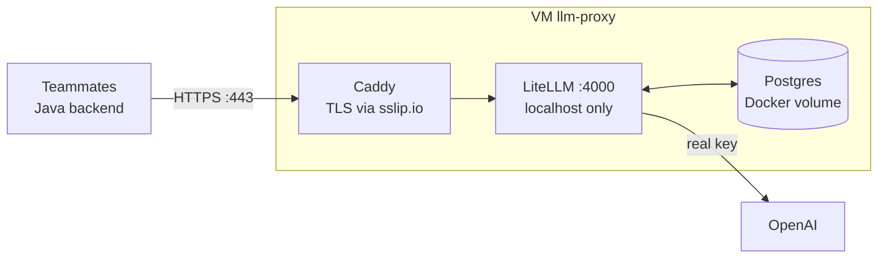

# Deploying the Jurong Marine LLM budget proxy on Google Cloud

How to run the LiteLLM budget proxy (this kit) on a Google Cloud Compute Engine
VM with HTTPS, so every teammate and the Java backend can reach it.

> **Our deployment:** `https://35-240-177-226.sslip.io` (VM `llm-proxy`, e2-small, asia-southeast1 / Singapore, Ubuntu 24.04 minimal, static IP `35.240.177.226`).
> Dashboard: `https://35-240-177-226.sslip.io/ui`



| Piece | Choice | Why |
|---|---|---|
| VM | `e2-micro`, us-central1 | Always Free tier (us-west1 / us-central1 / us-east1 only) |
| OS | Ubuntu 24.04 LTS **minimal** | Leaves more of the 1 GB RAM for LiteLLM + Postgres |
| HTTPS | Caddy + sslip.io hostname | Free, automatic Let's Encrypt certificate, no domain needed |
| IP | Reserved static IP | The URL never changes |

---

## 0. Before you start

- A Google Cloud project with billing enabled (new accounts get US$300 credit).
- `litellm-budget-proxy.zip` (this kit).
- The OpenAI key from the instructor.
- Open **Cloud Shell** (the `>_` icon top-right in the console). All
  `gcloud` commands below run in Cloud Shell, **not** inside the VM.

Set a budget alert first: **Billing → Budgets & alerts → Create budget** (e.g. US$5).

---

## 1. Create the VM (Cloud Shell)

```bash
PROJECT=your-project-id
REGION=us-central1
ZONE=us-central1-a

gcloud config set project $PROJECT
gcloud services enable compute.googleapis.com

# Static external IP
gcloud compute addresses create llm-proxy-ip --region=$REGION
IP=$(gcloud compute addresses describe llm-proxy-ip --region=$REGION --format='value(address)')
echo "Proxy URL will be: https://${IP//./-}.sslip.io"

# VM (note --tags=llm-proxy, used by the firewall rule)
gcloud compute instances create llm-proxy \
  --zone=$ZONE --machine-type=e2-micro \
  --image-family=ubuntu-minimal-2404-lts-amd64 --image-project=ubuntu-os-cloud \
  --boot-disk-size=30GB --boot-disk-type=pd-standard \
  --address=$IP --tags=llm-proxy

# Open only 80/443. Port 4000 is never exposed.
gcloud compute firewall-rules create allow-llm-proxy-https \
  --allow=tcp:80,tcp:443 --target-tags=llm-proxy
```

**Forgot the tag?** Add it to an existing VM:

```bash
gcloud compute instances add-tags llm-proxy --zone=$ZONE --tags=llm-proxy
```

Or use the console: VM → **Edit** → *Network tags* → add `llm-proxy` → **Save**.

---

## 2. Copy the kit to the VM (Cloud Shell)

Upload the zip to Cloud Shell (⋮ menu → **Upload**), then:

```bash
gcloud compute scp litellm-budget-proxy.zip llm-proxy:~ --zone=$ZONE
gcloud compute ssh llm-proxy --zone=$ZONE
```

Everything from here on runs **inside the VM**.

---

## 3. Prepare the VM

The minimal image leaves out some basic tools. Install them first:

```bash
sudo apt-get update
sudo NEEDRESTART_MODE=a apt-get install -y nano curl unzip
```

Docker (use the official script, **not** `snap install docker`):

```bash
curl -fsSL https://get.docker.com | sudo sh
sudo usermod -aG docker $USER && newgrp docker
docker --version && docker compose version
```

2 GB swap (e2-micro has only 1 GB RAM):

```bash
sudo fallocate -l 2G /swapfile && sudo chmod 600 /swapfile
sudo mkswap /swapfile && sudo swapon /swapfile
echo '/swapfile none swap sw 0 0' | sudo tee -a /etc/fstab
free -h      # Swap should show 2.0Gi
```

Unpack the kit:

```bash
unzip litellm-budget-proxy.zip && cd litellm-budget-proxy
```

---

## 4. Configure and start LiteLLM

**4a. Make LiteLLM listen on localhost only**, so it's reachable only through Caddy:

```bash
sed -i 's/- "4000:4000"/- "127.0.0.1:4000:4000"/' docker-compose.yml
grep 4000 docker-compose.yml     # expect: - "127.0.0.1:4000:4000"
```

(Or edit it by hand: `nano docker-compose.yml`. Use the arrow keys to move, **Ctrl+O** then Enter
to save, **Ctrl+X** to exit. Indent with spaces, never tabs.)

**4b. Fill in secrets:**

```bash
cp .env.example .env
python3 -c "import secrets; print('sk-' + secrets.token_hex(24))"   # run 2x: master key, salt key
nano .env
```

| Variable | Value |
|---|---|
| `OPENAI_API_KEY` | instructor's key |
| `LITELLM_MASTER_KEY` | generated `sk-...` (admins only) |
| `LITELLM_SALT_KEY` | generated `sk-...`, **never change after first start** |
| `POSTGRES_PASSWORD` | any strong password |
| `UI_PASSWORD` | strong, because the dashboard is public |
| `PROXY_URL` | leave as `http://localhost:4000` |

**4c. Check `config.yaml`:** keep only the models the course allows, and set
`max_budget` slightly **below** the real budget.

**4d. Start:**

```bash
docker compose up -d
docker compose logs -f litellm     # wait for "Application startup complete", then Ctrl+C
curl http://localhost:4000/health/liveliness
```

---

## 5. HTTPS with Caddy + sslip.io

sslip.io turns an IP into a hostname. **Every dot becomes a dash:**

| IP | Hostname |
|---|---|
| `35.240.177.226` | `35-240-177-226.sslip.io` ✅ |
| | `35-240.177.226.sslip.io` ❌ (dots left in, so the name doesn't resolve) |

Build it automatically on the VM so it can't be mistyped:

```bash
IP=$(curl -s -H "Metadata-Flavor: Google" \
  http://metadata.google.internal/computeMetadata/v1/instance/network-interfaces/0/access-configs/0/external-ip)
HOST=${IP//./-}.sslip.io
echo $HOST
nslookup $HOST        # must return your IP
```

Start Caddy:

```bash
docker run -d --name caddy --restart unless-stopped --network host \
  -v caddy_data:/data caddy:2 \
  caddy reverse-proxy --from $HOST --to localhost:4000

docker logs -f caddy      # wait for "certificate obtained successfully", then Ctrl+C
curl https://$HOST/health/liveliness
```

---

## 6. Create member keys and verify

```bash
nano members.json          # real names + budgets
python3 setup_keys.py      # prints one key per member, saves keys.json
```

End-to-end test with one member key:

```bash
curl https://$HOST/v1/chat/completions \
  -H "Authorization: Bearer <member key>" \
  -H "Content-Type: application/json" \
  -d '{"model":"gpt-4o-mini","messages":[{"role":"user","content":"Say hi"}],"max_tokens":20}'

python3 spend_report.py    # that member's spend should be > $0 (allow ~1 min)
```

Also check the dashboard: `https://$HOST/ui`, log in as `admin` / `UI_PASSWORD`, then open **Logs**.

---

## 7. Hand out access

Send each teammate privately:

- **Their own key**, never the master key, never `keys.json`
- Base URL `https://<HOST>`
- `examples/python_client.py` or `examples/java/ProxyClientExample.java`

```python
client = OpenAI(base_url="https://35-240-177-226.sslip.io", api_key="<member key>")
```

---

## Day-to-day operations (inside the VM, in `~/litellm-budget-proxy`)

| Task | Command |
|---|---|
| Status | `docker compose ps` and `docker ps` |
| Spend report | `python3 spend_report.py` |
| Daily tokens & cost | `python3 daily_report.py` (`--days 30`, `--by model`, `--csv usage.csv`) |
| LiteLLM logs | `docker compose logs -f litellm` |
| Caddy logs | `docker logs -f caddy` |
| Apply `docker-compose.yml` change | `docker compose up -d` |
| Apply `config.yaml` change | `docker compose restart litellm` |
| Add / change / remove members | edit `members.json`, then `python3 setup_keys.py --sync` (no restart) |
| Preview member changes | `python3 setup_keys.py --sync --dry-run` |
| Rename a member | `python3 setup_keys.py --rename OLD NEW` (never by editing `members.json` alone) |
| Stop (keeps data) | `docker compose down` |
| ⚠️ Wipe everything | `docker compose down -v` deletes all keys and spend history |

Containers restart automatically when the VM reboots.

**Backup spend history** (optional, before risky changes):

```bash
docker compose exec db pg_dump -U litellm litellm > backup_$(date +%F).sql
```

---

## Troubleshooting

| Symptom | Cause | Fix |
|---|---|---|
| `nano` / `curl` / `unzip: command not found` | Minimal image | `sudo apt-get install -y nano curl unzip` |
| `docker: command not found` | Docker not installed | Step 3 |
| `gcloud: command not found` | Running on the VM | `gcloud` commands go in **Cloud Shell** |
| `permission denied ... docker.sock` | Not in docker group yet | `newgrp docker` or log out and SSH back in |
| Caddy: `no valid A records found` | Hostname typo (dots left in) | `docker rm -f caddy`, rebuild `$HOST` (step 5), rerun |
| Caddy: timeout / connection error on challenge | Ports 80/443 blocked | Check firewall rule exists and VM has tag `llm-proxy` |
| Caddy: `address already in use` | Old Caddy container | `docker rm -f caddy`, rerun |
| HTTPS works but returns 502 | LiteLLM down | `docker compose ps`, `docker compose logs litellm` |
| LiteLLM keeps restarting | Out of memory | Check swap (`free -h`); else upgrade to e2-small (below) |
| Client gets `ExceededTokenBudget` / budget error | Cap reached | Expected. Raise the cap or wait for the reset |
| Spend stays $0 right after a call | Spend is written in batches | Wait ~1 minute |
| URL stopped working after VM stop/start | IP was ephemeral, not static | Promote the current IP: `gcloud compute addresses create llm-proxy-static --addresses=<NEW_IP> --region=$REGION`, then rerun Caddy (step 5) and send teammates the new URL. Delete any unused reserved address (`gcloud compute addresses list`), since idle reserved IPs are billed |

**Upgrade to e2-small** (2 GB RAM, ~US$12–15/month, or covered by the credits), from Cloud Shell:

```bash
gcloud compute instances stop llm-proxy --zone=$ZONE
gcloud compute instances set-machine-type llm-proxy --zone=$ZONE --machine-type=e2-small
gcloud compute instances start llm-proxy --zone=$ZONE
```

---

## Security checklist

- [ ] OpenAI key exists only in `.env` on the VM
- [ ] `.env` and `keys.json` never committed (`.gitignore` covers them)
- [ ] Port 4000 bound to `127.0.0.1`; firewall opens only 80/443
- [ ] Strong `UI_PASSWORD`; master key shared only with admins
- [ ] GCP billing budget alert set
- [ ] Instructor OK'd running the key on a group server

## Cost notes

- The e2-micro VM and a 30 GB standard disk are free in us-west1 / us-central1 / us-east1 (one per billing account).
- The external IPv4 address may incur a small hourly charge. Check **Billing → Reports**.
- sslip.io and Let's Encrypt are free. sslip.io is a community service with no uptime
  guarantee. If the team gets a domain, point it at the IP and use it in the Caddy `--from`.