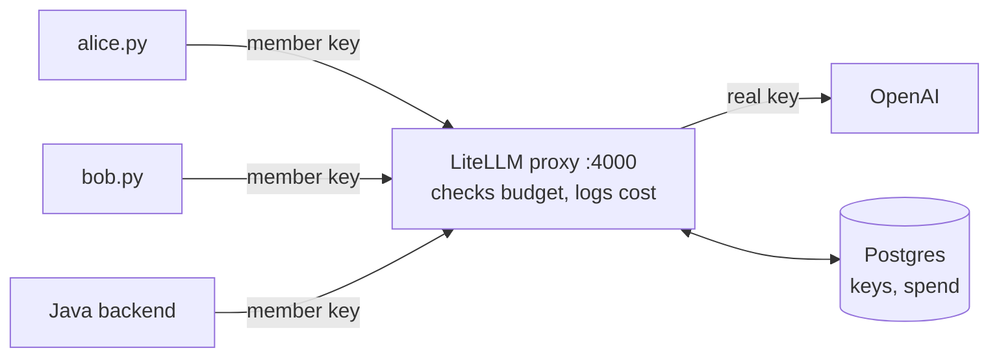

# Jurong Marine LLM proxy

One server holds the instructor's OpenAI key. Everyone else (Python scripts,
the Java backend) talks to this proxy with their **own virtual key**, and the
proxy enforces spending caps and logs every call.

> **Live deployment:** `https://35-240-177-226.sslip.io` on Google Cloud (Singapore, e2-small).
> To deploy or rebuild it, follow **[Deploying on Google Cloud](README-setup-gcp.md)**.



## Budget layers

| Layer | Where it's set | Default here | What happens when hit |
|---|---|---|---|
| Per-member key | `members.json` | $10 each, $10 for project / 30 days | Only that key is blocked |
| Team | `members.json` → `team` | $50 / 30 days | All member keys blocked |
| Global proxy | `config.yaml` → `max_budget` | $50 / 30 days | Every request blocked |
| OpenAI project limit | Instructor's dashboard | whatever they set | OpenAI returns `insufficient_quota` |

Set the team and global caps **a little below** the real budget. LiteLLM
calculates cost from list prices, so its numbers are close estimates, not the bill.

## 1. Start the proxy (admin, once)

Needs Docker Desktop (or Docker Engine + Compose). These steps run the proxy on
one machine; for the full Google Cloud setup (VM, static IP, HTTPS) see
[Deploying on Google Cloud](README-setup-gcp.md).

```bash
cp .env.example .env       # then edit .env: paste the OpenAI key, generate secrets
docker compose up -d
docker compose logs -f litellm     # wait for "Application startup complete", then Ctrl+C
curl http://localhost:4000/health/liveliness
```

Edit `config.yaml` so `model_list` contains only the models your course allows.

## 2. Create everyone's keys (admin)

Edit `members.json` with your real names and budgets, then:

```bash
python setup_keys.py
```

Send each person **only their own key**, privately. `keys.json` holds all of
them and is git-ignored. Keep it that way.

## 3. Use it (everyone)

Point the normal OpenAI SDK at the proxy; nothing else changes.

```python
client = OpenAI(base_url="http://<proxy-host>:4000", api_key="<your member key>")
```

```java
OpenAIOkHttpClient.builder().baseUrl("http://<proxy-host>:4000").apiKey("<backend key>").build();
```

Full examples with budget-error handling: `examples/python_client.py`,
`examples/java/ProxyClientExample.java`.

## Coding against the proxy

LiteLLM speaks the OpenAI API, so **write normal OpenAI SDK code**. Requests,
responses, streaming, tool/function calling, JSON/structured output and image
inputs (vision) all pass through unchanged. LangChain, LlamaIndex and similar
frameworks work too, because they accept a `base_url`.

### Keep the proxy out of the code

Both official SDKs read these environment variables automatically. Put them in
a git-ignored `.env`, never in source:

```bash
OPENAI_BASE_URL=https://35-240-177-226.sslip.io
OPENAI_API_KEY=<your member key>
```

```python
client = OpenAI()                                    # Python
```

```java
OpenAIClient client = OpenAIOkHttpClient.fromEnv();  // Java
```

The code is then identical to calling OpenAI directly. Switching between the
proxy and the real API is an environment change, not a code change.

### What's different

| # | Concern | What to do |
|---|---|---|
| 1 | **Only listed models are allowed.** Calls to any model not in `config.yaml` → `model_list` *and* the key's `models` in `members.json` fail with "key not allowed to access model". | Add every model the app uses, **including the embedding model** for document retrieval (e.g. `text-embedding-3-small`), to both files, then restart LiteLLM and run `setup_keys.py --sync`. |
| 2 | **New errors: rate limits and budgets.** Bulk jobs (log ingestion, embedding all SOPs) can hit `rpm_limit` (429) or a key's budget cap. | Batch many inputs per embedding request; retry 429s with backoff; catch budget errors and show a clear message, especially in the live demo. |
| 3 | **Stateful OpenAI features** (Assistants, Files, Vector Stores, Batch API) are only partly supported, and stored objects stay tied to the real key. | Don't use them. Use chat completions + embeddings with your own vector store (the brief expects you to build retrieval anyway). |
| 4 | **OpenAI Agents SDK tracing** uploads traces to OpenAI using the key, and fails with a proxy key. | `from agents import set_tracing_disabled; set_tracing_disabled(True)` |
| 5 | **`drop_params: true`** in `config.yaml` silently drops parameters a model doesn't support, which can hide bugs. | Consider `false` during development. |
| 6 | **Prompts pass through our VM** (Singapore). LiteLLM logs who called, which model, tokens and cost. | Be ready to explain this for PDPA. Check the dashboard's **Logs** page to confirm full prompt text isn't stored. |
| 7 | **The demo depends on the VM.** | Before demo day, check the proxy is up and budgets have headroom. Keep a fallback key ready to switch to by changing the env vars. |

Confirm with the instructor that putting a proxy in front of the class-provided
endpoint is allowed.

## 4. Watch spending (admin)

- `python spend_report.py` prints team and per-member spend vs. cap.
- `python daily_report.py` prints daily tokens and cost (see below).
- Dashboard: `http://<proxy-host>:4000/ui`, log in as `admin` / `UI_PASSWORD`.
  It shows spend per key and model, and a log of each request.

### Daily usage report

`daily_report.py` reads every logged request from the proxy database and
totals tokens and cost per day. Run it on the VM, in the kit folder:

```bash
python3 daily_report.py                    # last 7 days, per member
python3 daily_report.py --days 30          # last 30 days
python3 daily_report.py --by model         # per model
python3 daily_report.py --by member,model  # per member and model
python3 daily_report.py --by day           # one total per day
python3 daily_report.py --csv usage.csv    # also save as CSV (Excel, charts)
python3 daily_report.py --member ian-tan   # one member (repeat --member for several; quote names with spaces)
```

Dates are Singapore dates (`--tz` to change). Requests from deleted keys show as
`(unknown/deleted)`. It needs per-request logging, so it shows nothing if
`disable_spend_logs: true` is set in `config.yaml`.

To get the CSV off the VM (from Cloud Shell):
`gcloud compute scp llm-proxy:~/litellm-budget-proxy/usage.csv . --zone=$ZONE`

### How accurate is the cost tracking?

LiteLLM's costs are **close estimates, not OpenAI's bill**. It takes the token
counts OpenAI returns with every response (input, output, cached and image
tokens), which are exactly what OpenAI bills, and multiplies them by its own
per-model price list. Only the price list can be wrong.

| Source of error | Effect | Likelihood |
|---|---|---|
| LiteLLM's price list lags an OpenAI price change | Every call off by the same % | Low. LiteLLM fetches its latest price list at startup |
| Discounted/special tiers (cached input, batch, flex, priority) | Small differences on those calls | Low for normal chat + embeddings |
| Calls that bypass the proxy (real key used directly) | Not counted at all | Depends on discipline |
| Failed or interrupted requests | Slight differences either way | Rare |
| Spend is written to the DB in batches | Dashboard lags ~1 min | Always, harmless |

Expect it to be within a few percent of the real figure. That's why the caps
should sit a little below the real budget.

**Check one call yourself.** LiteLLM returns the cost it recorded in a response header:

```bash
curl -s -D - -o /dev/null <HOST>/v1/chat/completions \
  -H "Authorization: Bearer <member key>" -H "Content-Type: application/json" \
  -d '{"model":"gpt-4o-mini","messages":[{"role":"user","content":"Say hi"}],"max_tokens":20}' \
  | grep -i "x-litellm-response-cost"
```

Run the same request without `-D - -o /dev/null` to see the `usage` token counts, then compare:

```
cost = input_tokens × input_price + output_tokens × output_price   (per-token prices from openai.com/api/pricing)
```

If they match, LiteLLM's price for that model is right.

**Check against the real bill** (needs the instructor, since it requires OpenAI's
usage dashboard or an admin key). After a week or so, compare the project's
actual spend with the `spend_report.py` total. Investigate a gap of more than ~10%.

**Rate limits** (requests per minute) are a separate thing and are enforced exactly
by the proxy (`rpm_limit` / `tpm_limit` in `members.json`). OpenAI's own
per-organization limits still apply on top.

## Managing members

`members.json` is the source of truth. LiteLLM never reads it; `setup_keys.py`
applies it. **No restart is needed for any of these.** Key changes take effect within ~1 minute.

| Change | Command |
|---|---|
| Add a member | Add to `members.json`, then `python setup_keys.py` (or `--sync`) |
| Change budget / models / `rpm_limit` / `tpm_limit` | Edit `members.json`, then `python setup_keys.py --sync` |
| Change the team budget | Edit `team` in `members.json`, then `python setup_keys.py --sync` |
| Remove a member | Delete from `members.json`, then `python setup_keys.py --sync` (key is **blocked**, spend history kept) |
| Bring a removed member back | Add them back, then `--sync` (same key is unblocked) |
| **Rename** a member | `python setup_keys.py --rename OLD NEW` (same key, budget and history) |
| Preview any sync | `python setup_keys.py --sync --dry-run` |

`--sync` shows the planned changes and asks before applying (`--yes` skips the prompt).

⚠️ **Never rename by editing `members.json` and running `--sync`.** That blocks the
old key and creates a new one with a fresh budget. `--sync` warns you if it
sees a removal and an addition in the same run.

**Leaked key:** remove the member, `--sync` (blocks it), add them back under a
new name such as `alice-2`, `--sync` again, and send the new key.

## Response time tuning

A healthy proxy adds roughly **0.3–0.5 s** on top of OpenAI's own response time.
If calls feel slow, measure first, then fix the slowest part.

### Measure

Replace `<HOST>` with the proxy URL (e.g. `https://35-240-177-226.sslip.io`).

```bash
# a) Proxy only: network + HTTPS + Caddy, no OpenAI involved (from your laptop)
curl -s -o /dev/null -w "a total %{time_total}s\n" <HOST>/health/liveliness

# b) OpenAI directly, bypassing the proxy (on the VM, in the kit folder)
curl -s -o /dev/null -w "b total %{time_total}s\n" https://api.openai.com/v1/chat/completions \
  -H "Authorization: Bearer $(grep ^OPENAI_API_KEY .env | cut -d= -f2)" -H "Content-Type: application/json" \
  -d '{"model":"gpt-4o-mini","messages":[{"role":"user","content":"Say hi"}],"max_tokens":20}'

# c) Same request through the proxy (from your laptop; run 3x, since the first call warms the key cache)
for i in 1 2 3; do
curl -s -o /dev/null -w "c total %{time_total}s\n" <HOST>/v1/chat/completions \
  -H "Authorization: Bearer <member key>" -H "Content-Type: application/json" \
  -d '{"model":"gpt-4o-mini","messages":[{"role":"user","content":"Say hi"}],"max_tokens":20}'
done
```

While (c) runs, check the VM in a second SSH window: `docker stats --no-stream` and `free -h`.

### Read the results

| Result | Bottleneck | Go to |
|---|---|---|
| (a) > ~1 s | Network, Caddy or an overloaded VM | VM size; check `docker logs caddy` |
| (c) − (b) > ~1 s | LiteLLM / VM (CPU, memory, swap) | VM size, then logging |
| (b) itself slow | OpenAI: model and answer length | Client-side |
| Only the first (c) is slow | Normal warm-up (key cache, connections) | Nothing to fix |

### Fixes, in order of impact

**1. VM size.** LiteLLM checks the key, budget and cost on every request, and Postgres
writes the spend. On a 1 GB e2-micro this swaps and throttles.

| VM | Our measurement (b → c) | Notes |
|---|---|---|
| e2-micro (1 GB) | 2.0 s → **6.3 s** (+4.3 s) | Too small |
| e2-small (2 GB) | (c) **1.4–1.5 s** over 3 runs | ✅ Current deployment. Proxy overhead is now negligible |
| e2-medium (4 GB) | | Next step if e2-small is still slow |

Resize steps are in [Deploying on Google Cloud → Troubleshooting](README-setup-gcp.md#troubleshooting).
Make sure the IP is static first.

**2. Quieter logging.** Add this under the `litellm` service's `environment:` in
`docker-compose.yml`, then run `docker compose up -d`:

```yaml
      LITELLM_LOG: "ERROR"
```

**3. Skip per-request log rows** (only if still slow). Add this under `general_settings:`
in `config.yaml`, then run `docker compose restart litellm`:

```yaml
  disable_spend_logs: true
```

Budgets and per-key spend are still tracked and enforced; you lose only the
request-by-request history on the dashboard's **Logs** page.

**4. Client-side** (these often matter more than anything on the server):

- **Stream responses** (`stream=True` in Python, `createStreaming` in Java). The first words
  appear in under a second instead of after the full answer.
- Prefer `gpt-4o-mini` over `gpt-4o` where quality allows.
- Keep `max_tokens` / `maxCompletionTokens` low. Output length dominates response time.
- Reuse one client object per process, so HTTPS connections are kept alive between calls.

**Region:** a Singapore VM is the right choice for a Singapore team. Each request
crosses the Pacific once either way, and new HTTPS handshakes stay short. Moving
the VM to the US won't make it faster.

## Where to host it so teammates can reach it

- **Testing:** `localhost:4000` only works on your own machine.
- **Same network:** `http://<your-LAN-IP>:4000`. Works on home Wi-Fi; campus Wi-Fi often blocks it.
- **Small cloud VM** (2 GB RAM or more; 1 GB proved too slow, see Response time tuning): install
  Docker, copy this folder, `docker compose up -d`. Put HTTPS in front (e.g. Caddy) or at
  least restrict the firewall so port 4000 isn't open to the whole internet.
  Our setup: [Deploying on Google Cloud](README-setup-gcp.md).
- **Temporary tunnel:** `cloudflared tunnel --url http://localhost:4000` gives an HTTPS URL
  while your laptop is on. Fine for a demo, not for daily use.

## Security checklist

- The real OpenAI key lives only in `.env` on the proxy server.
- `.env` and `keys.json` are never committed (see `.gitignore`).
- The master key and `UI_PASSWORD` are for admins only. Members get virtual keys.
- Check with your instructor that running the key on a group server is OK.

## Reset everything

`docker compose down -v` deletes the database: all keys, teams and spend history.
Delete `keys.json` as well before running `setup_keys.py` again.